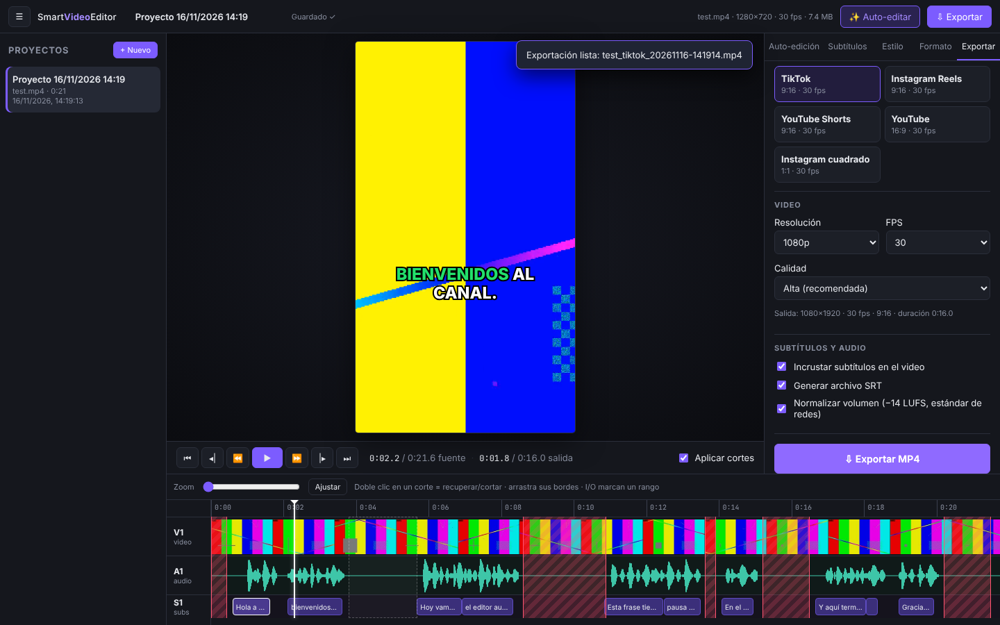
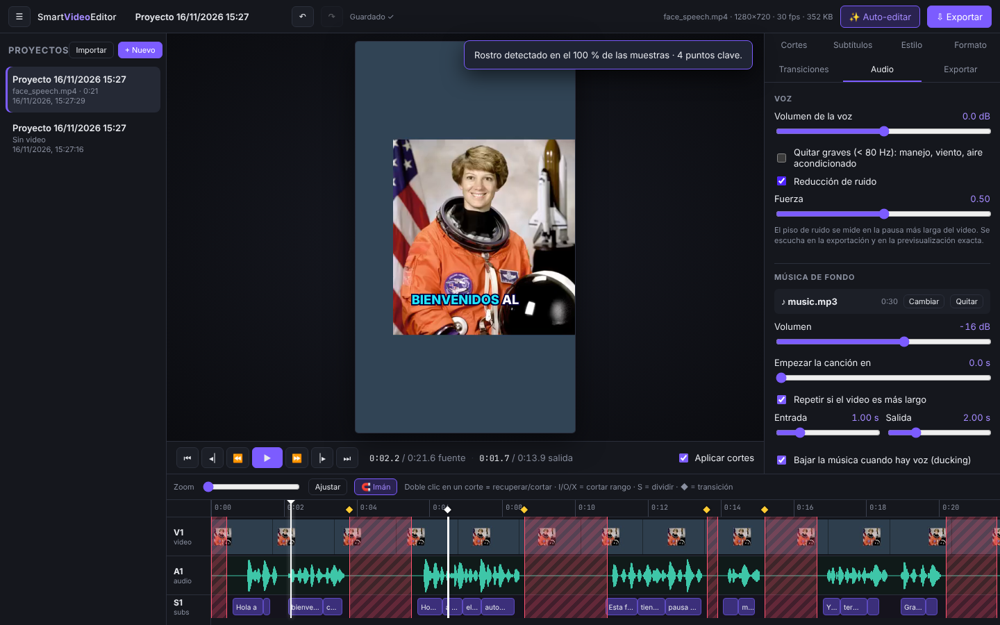

# Smart Video Editor

Editor de video local que importa un video, lo transcribe, propone cortes de silencios,
genera subtítulos editables con estilo y exporta para TikTok, Reels, Shorts y YouTube con FFmpeg.

Estado: **etapas 0 a 5 completas; etapa 6 parcial** (ejecutable autónomo listo, falta envoltorio nativo e instaladores). Diseño completo, riesgos y plan de etapas en [`docs/ARQUITECTURA.md`](docs/ARQUITECTURA.md).





## Requisitos

| Herramienta | Versión probada | Para qué |
|---|---|---|
| Python | 3.13 (≥ 3.10) | Motor y API |
| Node.js | 22 (≥ 18) | Compilar la interfaz |
| FFmpeg + FFprobe | 6.1, con `libx264` y `libass` | Todo el procesamiento (no hace falta en el ejecutable empaquetado si se incluye) |
| Conexión a internet | solo la primera vez por modelo | Descarga del modelo Whisper desde HuggingFace (tiny 75 MB · base 145 MB · small 480 MB) |

FFmpeg: en Windows `winget install Gyan.FFmpeg`; en macOS `brew install ffmpeg`; en Linux `apt install ffmpeg`.

## Instalación rápida (un comando)

Descarga el proyecto (botón verde **Code → Download ZIP** en GitHub, o `git clone`) y, dentro de la carpeta:

- **Windows 10/11** (PowerShell):

```powershell
powershell -ExecutionPolicy Bypass -File scripts\instalar.ps1
```

- **macOS / Linux** (Terminal):

```bash
bash scripts/instalar.sh
```

El instalador revisa Python, Node y FFmpeg, instala los que falten (winget en Windows, Homebrew en macOS,
apt en Linux), prepara todo y crea el lanzador: un acceso **Smart Video Editor** en el escritorio de Windows,
o `iniciar.command` en macOS. Probado en Linux (41 s sobre un clon limpio); en Windows y macOS aún no se ha probado.

## Instalación manual

```bash
cd backend
```

```bash
python -m venv .venv && source .venv/bin/activate   # Windows: .venv\Scripts\activate
```

```bash
pip install -r requirements.txt
```

```bash
cd ../frontend && npm install && npm run build
```

## Uso

```bash
cd backend && python -m app
```

Abre `http://127.0.0.1:8765` en el navegador. Los proyectos, proxies y exportaciones se guardan
en `~/SmartVideoEditor` (cambiable con la variable `SVE_WORKSPACE`). Los videos originales
nunca se modifican.

Flujo típico:

1. **+ Nuevo** proyecto → arrastra un MP4/MOV/MKV (o usa la ruta local para archivos grandes, sin copiarlos).
2. **Subtítulos → Transcribir** (modelo `base` por defecto, español).
3. **✨ Auto-editar**: detecta pausas y las marca como cortes (rayado rojo en la línea de tiempo).
4. Revisa: doble clic en un corte para recuperarlo, arrastra sus bordes, o marca un rango con **I** / **O** y pulsa **X** para cortar a mano.
5. **Formato** 9:16 / 16:9 / 1:1 y **Estilo** de subtítulos. La vista previa refleja ambos en vivo.
6. **Transiciones**: elige una para todas las uniones o ajusta cada ◆ por separado; **▶ Previsualización exacta** renderiza 3 s reales con FFmpeg.
7. **Audio**: reducción de ruido, música de fondo con ducking y fundidos.
8. **Exportar**: elige perfil de plataforma → MP4 (+ SRT opcional).

### Atajos de teclado

| Tecla | Acción |
|---|---|
| Espacio | Reproducir / pausa |
| ← / → (Shift: ×5) | −1 s / +1 s |
| , / . | −1 / +1 frame |
| I / O / X | Marcar entrada / salida / eliminar el rango marcado |
| S | Dividir en el cabezal (unión sin quitar material, para poner una transición) |
| Ctrl+Z / Ctrl+Shift+Z (o Ctrl+Y) | Deshacer / rehacer (también deshace auto-edición y transcripción) |
| Alt mientras arrastras | Desactiva el imán |
| Supr | Recuperar o volver a cortar el corte seleccionado |
| Esc | Quitar selección y marcas |

### Desarrollo

```bash
scripts/dev.sh
```

Interfaz con recarga en caliente en `http://localhost:5173`.

## Ejecutable autónomo (etapa 6)

```bash
scripts/build_desktop.sh /carpeta/con/ffmpeg_y_ffprobe
```

Genera `dist/SmartVideoEditor/` (646 MB en Linux, con FFmpeg incluido en `dist/SmartVideoEditor/ffmpeg/`).
Al ejecutarlo levanta el motor y abre el navegador. Requiere `pip install pyinstaller` y debe
construirse en cada sistema operativo de destino (PyInstaller no compila de forma cruzada).
Probado en Linux con un PATH sin FFmpeg: importar, transcribir, auto-editar, escenas, rostro y exportar funcionaron.

## Pruebas

```bash
cd backend && python -m pytest -q
```

```bash
cd frontend && npm test && npm run typecheck
```

```bash
node e2e/smoke.cjs ruta/al/video.mp4 carpeta_capturas
```

El último requiere la app corriendo y Playwright instalado. Los tests de backend generan sus
propios videos de prueba con FFmpeg; los de voz usan `espeak-ng` (`scripts/make_test_video.sh`) y se
omiten si no está instalado.

```bash
node e2e/stages.cjs video_con_rostro_y_voz.mp4 musica.mp3 carpeta_capturas
```

Resultado actual: 72 tests de backend, 8 de frontend y las dos pruebas E2E en navegador, todos pasando.

## Qué funciona (verificado con tests)

| Función | Estado | Cómo se verificó |
|---|---|---|
| Importar MP4 / MOV / MKV (subida o ruta local sin copiar) | ✅ | API + E2E; rechaza extensiones no soportadas y archivos corruptos |
| Análisis: duración, resolución, FPS, códecs, rotación | ✅ | `test_media.py` |
| Proxy H.264 ≤720p, miniaturas, forma de onda (job en segundo plano) | ✅ | `test_media.py` |
| Transcripción Faster-Whisper con tiempos por palabra, modelo e idioma elegibles | ✅ | `test_transcribe.py` (modelo tiny) |
| Detección de silencios (FFmpeg `silencedetect`) | ✅ | Posición de silencios con error ≤ 50 ms |
| Cortes inteligentes: aire configurable, más aire a mitad de frase, protección de palabras, fusión de sonidos sueltos | ✅ | `test_autoedit.py` |
| Revisar, recuperar, ajustar, borrar y crear cortes manuales | ✅ | E2E |
| Previsualización con salto de cortes en vivo (sin render) | ✅ | E2E |
| Subtítulos: edición de texto con retiming automático, borrar, reagrupar por palabras/caracteres | ✅ | `test_subtitles.py`, `timemap.test.ts` |
| Estilo: fuente instalada, tamaño, negrita, mayúsculas, colores, contorno, sombra, posición, 5 preajustes | ✅ | Comparación vista previa vs fotograma exportado |
| Resaltado de la palabra que se dice (karaoke) | ✅ | ASS con un evento por palabra |
| Exportar SRT ajustado a los cortes | ✅ | `test_render.py`, `test_api.py` |
| Formatos 9:16, 16:9, 1:1 con recorte (posición X/Y + zoom), fondo desenfocado o barras | ✅ | Dimensiones de salida verificadas |
| Exportación MP4 H.264/AAC con perfiles TikTok, Reels, Shorts, YouTube, Instagram cuadrado; resolución y FPS configurables | ✅ | `test_render.py` |
| Normalización de volumen a −14 LUFS | ✅ | Medido: −14,9 LUFS |
| Sincronía audio/video tras cortes | ✅ | Diferencia < 10 ms con cortes reales; < 70 ms con 41 segmentos; sin saltos en el audio |
| Jobs con progreso, cancelación y limpieza de archivos parciales | ✅ | `test_api.py::test_upload_and_cancel_export` |
| Autoguardado con control de versiones (evita pisar resultados de un proceso) | ✅ | Conflicto 409 probado |
| Persistencia de proyectos (SQLite) y copia `.json` descargable | ✅ | E2E: recarga de página |
| **Etapa 2** · Deshacer / rehacer (100 pasos, agrupa arrastres de deslizadores) | ✅ | E2E: 6 cortes → 0 → 6 |
| Divisiones (S) e imán a palabras, escenas, cortes y cabezal | ✅ | `test_edit_segments_with_splits`, E2E |
| Animaciones de subtítulos: pop, fundido, subir, palabra a palabra (vista previa y render) | ✅ | `test_subtitle_animations`, render |
| 8 preajustes de estilo (nuevos: Neón pop, Podcast, Máquina de escribir) | ✅ | E2E |
| Importar proyecto `.json` y reconectar el video si cambió de lugar | ✅ | `test_import_project_and_relink` |
| **Etapa 3** · Detección de cambios de escena (PySceneDetect) | ✅ | Escenas en 2,0 y 4,5 s detectadas con error ≤ 80 ms |
| Reencuadre siguiendo el rostro (cámara virtual suave) | ✅ | 100 % de detección; cámara a < 0,02 del rostro |
| Zoom alternado por segmento (jump cut) | ✅ | Render con 31 segmentos |
| **Etapa 4** · Transiciones: fundido, disolución, zoom, desenfoque, deslizamiento, flash | ✅ | Las 6 preservan duración (±45 ms) y sincronía (< 25 ms) |
| Duración, intensidad (fundido/flash/zoom/desenfoque) y dirección (deslizamiento) | ✅ | Luminancia medida en la unión: intensidad 1 → negro, 0,5 → gris medio, 0 → intacto |
| Aplicación masiva (por defecto) o individual por unión; divisiones en cada escena | ✅ | API + E2E |
| Previsualización exacta: render parcial de 3 s con FFmpeg | ✅ | `test_jump_zoom_and_window_render`, E2E (3,00 s) |
| **Etapa 5** · Reducción de ruido con piso de ruido medido automáticamente | ✅ | Ruido en pausa −30 dB, voz intacta |
| Paso alto (80 Hz), volumen de voz | ✅ | Render |
| Música de fondo: volumen, inicio, repetición, fundidos de entrada/salida | ✅ | Nivel = original −16 dB (±1,5) |
| Ducking (la música baja cuando hay voz) | ✅ | Banda de la música ≥ 6 dB más baja bajo la voz |
| Fundido a negro de entrada y salida del resultado (imagen y sonido) | ✅ | Luminancia y nivel medidos |
| **Etapa 6** · Ejecutable autónomo con FFmpeg incluido | ✅ Linux | Flujo completo por API sin FFmpeg en el sistema |

## Pendiente (no implementado)

| Función | Etapa | Motivo |
|---|---|---|
| Envoltorio nativo con Tauri (ventana propia, diálogos de archivo con ruta real) | 6 | Requiere Rust y SDK de cada sistema; no se pudo verificar en este entorno |
| Instaladores firmados para Windows (.msi) y macOS (.dmg) | 6 | Requiere construir y firmar en cada sistema |
| Reducción del tamaño del ejecutable (hoy 646 MB) | 6 | PyAV (101 MB) lo importa faster-whisper aunque no se use |
| Seguimiento de rostros de perfil o varias personas | 3 | Hoy: rostro frontal principal |
| Previsualización en vivo exacta de disolución y deslizamiento | 4 | En vivo se aproximan; la previsualización exacta sí es real |

## Limitaciones conocidas

- **Videos largos**: ver la medición con un video de 20 min en la sección siguiente.
- **Subir un archivo lo copia** a la carpeta del proyecto (el navegador no entrega la ruta real). Para archivos de varios GB usa "usar desde su ubicación".
- **Volver a auto-editar** reemplaza los cortes de silencio (los manuales y las divisiones se conservan); se puede deshacer con Ctrl+Z. **Volver a transcribir** reemplaza los subtítulos.
- **Vista previa en vivo**: subtítulos, formato, rostro, zoom, fundidos y flash coinciden con el render; disolución y deslizamiento se aproximan, y la reducción de ruido y el ducking exacto solo se oyen en la previsualización exacta y la exportación.
- **Seguimiento de rostro**: detector Haar de rostros frontales; perfiles y caras pequeñas (< 1/32 del ancho) pueden perderse. Si no encuentra rostro, el proceso avisa y no cambia el encuadre.
- **Disolución y deslizamiento** necesitan material eliminado a ambos lados: en divisiones (sin corte) se omiten y la exportación informa cuántas.
- Se usa solo la primera pista de audio del archivo.
- Videos de FPS variable (celulares): la exportación fuerza FPS constante; no se ha probado aún con grabaciones reales de teléfono.
- Probado en Linux. Windows y macOS no se han probado todavía.

## Rendimiento con un video largo

Video de 20 min 13 s (1280×720, 30 fps, 716 MB, voz con pausas reales) en una CPU de 4 núcleos sin GPU.
Script: `scripts/bench_long.py`.

| Etapa | Tiempo | Velocidad |
|---|---|---|
| Análisis (ffprobe) | 0,1 s | |
| Miniaturas | 19,6 s | |
| Forma de onda | 4,5 s | |
| Proxy 720p | 182,6 s | 6,6× tiempo real |
| Transcripción Whisper `base` (1.655 palabras) | 66,0 s | 18× tiempo real |
| Detección de silencios + reglas de corte (208 cortes) | 4,1 s | |
| Cambios de escena (sobre el proxy) | 46,3 s | |
| Exportación 1080×1920, 207 segmentos, 206 transiciones, 529 subtítulos, normalización | 405,7 s | 2,2× tiempo real (salida de 14 min 36 s) |

Sincronía del resultado: video 876,200 s, audio 876,166 s (1 fotograma de diferencia en 14,6 min).
Al importar, el editor queda usable en ~3,5 min (proxy); la transcripción puede correr en paralelo.
